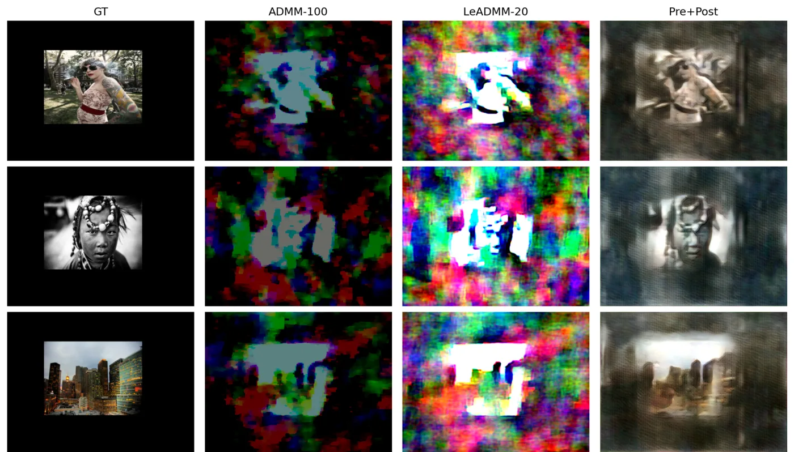
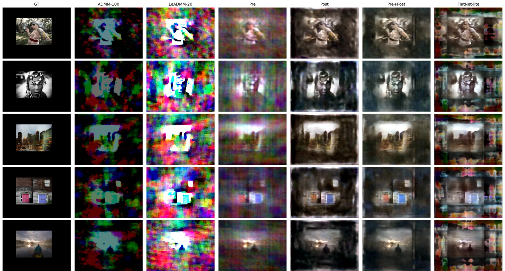

# Lensless Computational Imaging

Recovering photos from a camera with no lens. I compare classical ADMM, unrolled learned ADMM, and hybrid models that add DRUNet-style CNNs around the solver, on real measurements from the DigiCam lensless camera.



<sub>Three of the five report images. The grid script picks images evenly spaced through the test split, not by hand. Columns: lensed ground truth, fixed ADMM-100, LeADMM-20 (learned step sizes), and my best model, LeADMM-5 + DRUNet pre+post. Full 5-image, 7-method grid: [Results](#results).</sub>

**Best result:** 17.31 dB PSNR, 0.445 SSIM and 0.577 LPIPS on the full DigiCam test split (1,500 real measurements). The classical ADMM-100 baseline gets 10.57 dB and is about 16x slower per image.

## The problem

A lensless camera puts a thin optical mask in front of the sensor instead of a lens. DigiCam uses a programmable LCD as the mask. Every scene point spreads over most of the sensor, so the raw measurement looks like colored noise. To recover the image, you invert a large, poorly conditioned convolution with the camera's point spread function (PSF).

That is hard for three reasons:
- The problem is ill-posed.
- The real optics do not match the simulated PSF exactly.
- The dataset changes the mask pattern between captures (100 different patterns).

The dataset is [`bezzam/DigiCam-Mirflickr-MultiMask-10K`](https://huggingface.co/datasets/bezzam/DigiCam-Mirflickr-MultiMask-10K). It has 8,500 training and 1,500 test pairs, each a real lensless measurement with an aligned lensed reference photo.

## What I built

- **Physics forward model and fixed ADMM-100:**
  - Total-variation prior and FFT convolution with zero padding.
  - Conjugate-gradient x-update (10 CG steps per iteration) and soft-thresholded TV splitting.
  - Background subtraction on the output.
  - Code: `src/model/admm.py`, `src/utils/{fft,tv,padding,background}.py`.
- **Unrolled learned ADMM (LeADMM):** the same solver with a learned step size `mu_i` and TV weight `tau_i` per layer (softplus-parameterised). 20 layers give 40 trainable scalars (`src/model/unrolled_admm.py`).
- **Modular hybrids:** residual U-Net (DRUNet-style) processors before and/or after a 5-layer LeADMM, trained end to end (`src/model/modular_admm.py`, `src/model/drunet.py`).
- **FlatNet-lite (bonus, non-ADMM):** Wiener deconvolution with learned per-channel regularisation, scale and bias, followed by a U-Net (`src/model/flatnet.py`).
- **Data pipeline:**
  - Hugging Face dataset loader.
  - Per-mask PSF simulated with wave propagation, cached per mask.
  - 180° rotation of the measurement and an aligned crop of the lensed target.
  - Code: `src/datasets/digicam.py`, `src/utils/psf.py`, `src/utils/digicam_preprocess.py`.
- **Training:**
  - Hydra configs.
  - Loss: MSE + 0.1 × LPIPS(VGG), computed on the scene region.
  - Gradient clipping and Comet logging.
  - Code: `train.py`, `src/loss/`, `src/trainer/`, `src/configs/` (the trainer and logging scaffold comes from an MIT project template; see [Credits](#credits)).
- **Evaluation and release:**
  - Metrics on the scene region of interest (ROI): PSNR, SSIM, MSE, LPIPS (`calculate_metrics.py`).
  - GPU speed benchmark (`measure_speed.py`).
  - Report tables and grids (`scripts/`).
  - Checkpoints on Hugging Face with a downloader (`download_checkpoints.py`).
  - A notebook that runs the best model on your own data (`notebooks/demo.ipynb`).

## Results

All numbers are on the **full DigiCam test split** (n = 1,500), computed only inside the displayed scene, ROI `[80:280, 100:366]`. Each method is a single training run.

| Method | Pipeline | Params | PSNR (dB) ↑ | SSIM ↑ | MSE ↓ | LPIPS ↓ | s / image ↓ |
| --- | --- | ---: | ---: | ---: | ---: | ---: | ---: |
| ADMM-100 + bg sub | measurement → ADMM-100 → background subtraction | 0 | 10.57 | 0.241 | 0.113 | 0.820 | 1.050 |
| LeADMM-20 | measurement → unrolled ADMM-20 | 40 | 8.15 | 0.238 | 0.160 | 0.766 | 0.209 |
| LeADMM-5 + DRUNet pre | measurement → DRUNet → LeADMM-5 | 8.34M | 15.29 | 0.310 | 0.035 | 0.686 | 0.063 |
| LeADMM-5 + DRUNet post | measurement → LeADMM-5 → DRUNet | 8.34M | 16.69 | 0.422 | 0.026 | 0.597 | 0.063 |
| **LeADMM-5 + DRUNet pre+post** | measurement → DRUNet → LeADMM-5 → DRUNet | 8.51M | **17.31** | **0.445** | **0.023** | **0.577** | 0.065 |
| FlatNet-lite (bonus) | measurement → learned Wiener → U-Net | 2.73M | 16.12 | 0.380 | 0.029 | 0.606 | **0.005** |

**Sources:**
- Quality: [`reports/tables/final_metrics.csv`](reports/tables/final_metrics.csv). [`notebooks/full_test_best_model.ipynb`](notebooks/full_test_best_model.ipynb) re-runs inference and metrics for the five learned models on all 1,500 test images and gets the same values.
- Speed: [`reports/tables/speed.csv`](reports/tables/speed.csv). It is the mean over 50 test images after 5 warm-up images, batch size 1, on one CUDA GPU (the GPU model was not recorded).
- Parameter counts: I checked them against the layer definitions.

What the numbers show:
- **The learned CNN modules do most of the work.** Post-processing alone reaches 16.69 dB, and adding a pre-processor gives another 0.63 dB. Overall that is +6.75 dB over fixed ADMM-100, while running about 16x faster because the solver needs only 5 iterations.
- **Learning only the ADMM step sizes did not help here.** LeADMM-20 scored 2.4 dB below ADMM-100. Part of that gap may come from LeADMM-20 not using the background subtraction that ADMM-100 has.
- **FlatNet-lite is the speed/quality trade-off.** It is 1.2 dB below the best model with about 3x fewer parameters, and it is about 13x faster (0.005 s per image).



<sub>The same five evenly spaced test images for all methods. This is a re-encoded copy for the README. The full-resolution originals are [`final_comparison_grid.png`](reports/assets/qualitative/final_comparison_grid.png) and [`final_comparison_grid_compact.png`](reports/assets/qualitative/final_comparison_grid_compact.png), made by `scripts/make_qualitative_grid.py`.</sub>

The full write-up is [`notebooks/report.ipynb`](notebooks/report.ipynb). It covers per-method setup, benefits and drawbacks, bar charts and the speed comparison. It also lists what worked:
- the wave-propagation PSF
- ROI metrics instead of full-frame PSNR
- background subtraction
- the pre+post architecture

And what did not:
- a naive resized-mask PSF
- LeADMM-20 alone
- tiny residual CNNs

## How it works

The measurement is modelled as `y = crop(h * x)`. Here `h` is the PSF simulated from the LCD mask pattern, `*` is 2-D convolution done with FFTs on a zero-padded grid, and `crop` keeps the sensor area.

ADMM with a TV prior splits the problem into three steps per iteration:
- a quadratic x-update, solved with conjugate gradients
- soft-thresholding of the image gradients
- a dual update

Unrolling fixes the number of iterations and makes `mu_i` and `tau_i` trainable. The hybrid model wraps a 5-layer unrolled solver between two CNNs and trains everything end to end:

```
lensless measurement ─► DRUNet (pre) ─► LeADMM-5 (PSF from mask) ─► DRUNet (post) ─► reconstruction
```

The pre-CNN cleans the measurement before inversion, and the post-CNN removes the remaining blur and artifacts. FlatNet-lite replaces the iterative solver with one learned Wiener filter in the Fourier domain, followed by a U-Net.

## Tech stack

PyTorch 2.2, Hydra / OmegaConf, Hugging Face `datasets` and `huggingface_hub`, torchmetrics and `lpips`, `waveprop` (PSF simulation), Comet ML (training logs), NumPy / SciPy / OpenCV.

## Running locally

Configs live in `src/configs/`. Metrics use ROI crop `[80:280, 100:366]`.

### Setup

```bash
python -m venv .venv
source .venv/bin/activate
pip install -r requirements.txt
python scripts/download_digicam_masks.py   # mask_0.npy … mask_99.npy into data/digicam_masks/
```

Dataset pulls from HuggingFace on first run. For Comet logging during training, I put my API key in `private_tokens.py` (gitignored).

```bash
python download_checkpoints.py --name leadmm5_prepost_drunet8m.pth   # demo / best model
python download_checkpoints.py --all                               # all report checkpoints
```

Checkpoints live on HF: [`tolyho/lensless-computational-imaging-checkpoints`](https://huggingface.co/tolyho/lensless-computational-imaging-checkpoints).

| Method | Config | Checkpoint |
| --- | --- | --- |
| ADMM-100 + bg sub | `inference` | none |
| LeADMM-20 | `inference_leadmm20` | `checkpoints/leadmm20.pth` |
| DRUNet pre | `inference_modular_pre` + `model=modular_leadmm5_pre_drunet8m` | `checkpoints/leadmm5_pre_drunet8m.pth` |
| DRUNet post | `inference_modular_post` + `model=modular_leadmm5_post_drunet8m` | `checkpoints/leadmm5_post_drunet8m.pth` |
| DRUNet pre+post | `inference_modular_prepost` + `model=modular_leadmm5_prepost_drunet8m` | `checkpoints/leadmm5_prepost_drunet8m.pth` |
| FlatNet-lite | `inference_flatnet` | `checkpoints/flatnet_lite.pth` |

### Inference

Default `-cn inference` is fixed ADMM-100 + background subtraction (no checkpoint).

```bash
.venv/bin/python inference.py -cn inference

.venv/bin/python inference.py -cn inference_leadmm20 \
  checkpoint=outputs/train_leadmm20/checkpoint-epochN.pth \
  output_dir=outputs/digicam_leadmm20

.venv/bin/python inference.py -cn inference_modular_prepost \
  model=modular_leadmm5_prepost_drunet8m \
  checkpoint=outputs/train_leadmm5_drunet8m_prepost_ep10/leadmm5_drunet8m_prepost_ep10/model_best.pth \
  output_dir=outputs/final_leadmm5_drunet8m_prepost
```

Best model from the released checkpoint:

```bash
python inference.py -cn inference_modular_prepost \
  model=modular_leadmm5_prepost_drunet8m \
  checkpoint=checkpoints/leadmm5_prepost_drunet8m.pth \
  output_dir=outputs/final_leadmm5_drunet8m_prepost
```

### Metrics

Compare `recon/` vs `lensed/` from an inference run:

```bash
.venv/bin/python calculate_metrics.py \
  pred_dir=outputs/digicam_simple_admm100/recon \
  gt_dir=outputs/digicam_simple_admm100/lensed \
  output_path=outputs/digicam_simple_admm100/metrics.json
```

### Report assets

```bash
python scripts/build_report_tables.py
python scripts/make_qualitative_grid.py --num-samples 5
python measure_speed.py --num-images 50 --warmup 5 --device cuda \
  --output-path reports/tables/speed.json
```

### Training

Example: train LeADMM-20. I logged runs to Comet via `-cn train_comet`.

```bash
.venv/bin/python train.py -cn train_comet \
  model.num_iters=20 model.cg_iters=10 \
  datasets.train.limit=null datasets.val.limit=null \
  trainer.n_epochs=6 \
  trainer.save_dir=outputs/train_leadmm20 \
  writer.run_name=leadmm20 \
  optimizer.lr=1e-3 \
  trainer.max_grad_norm=100 \
  trainer.log_step=50
```

### Modular Models

LeADMM-5 unrolled core with DRUNet before/after. Pre+post worked best for me.

```bash
.venv/bin/python train.py -cn train_comet \
  model=modular_leadmm5_prepost_drunet8m \
  trainer.n_epochs=10 \
  trainer.save_dir=outputs/train_leadmm5_drunet8m_prepost_ep10 \
  writer.run_name=leadmm5_drunet8m_prepost_ep10
```

### FlatNet-Lite

Bonus baseline: I learn only Wiener λ/scale/bias, then DRUNet cleans up. Debug run first, then full training:

```bash
# debug
.venv/bin/python train.py -cn train_comet \
  model=flatnet_lite \
  datasets.train.limit=20 datasets.val.limit=5 \
  trainer.n_epochs=1 optimizer.lr=1e-4 \
  trainer.save_dir=outputs/train_flatnet_lite_debug \
  writer.run_name=flatnet_lite_debug

# full (10 epochs)
.venv/bin/python train.py -cn train_comet \
  model=flatnet_lite \
  datasets.train.limit=null datasets.val.limit=null \
  trainer.n_epochs=10 optimizer.lr=1e-4 \
  trainer.save_dir=outputs/train_flatnet_lite \
  writer.run_name=flatnet_lite

# follow training log
tail -f outputs/train_flatnet_lite/flatnet_lite/info.log

.venv/bin/python inference.py -cn inference_flatnet \
  checkpoint=outputs/train_flatnet_lite/flatnet_lite/checkpoint-epoch10.pth \
  output_dir=outputs/final_flatnet_lite
```

### Custom Data

Run on your own folder layout (`lensless/*.png` and `masks/*.npy` with matching names; `lensed/` is optional and only needed for metrics):

```bash
.venv/bin/python inference.py -cn inference_custom \
  dataset.root=/path/to/data \
  output_dir=outputs/custom_run
```

[`notebooks/demo.ipynb`](notebooks/demo.ipynb) does the same in Colab from a zip link. It downloads the best checkpoint, runs inference, plots samples, and computes metrics when `lensed/` is present.

## Limitations / current status

- **Reproducibility:** Training curves are hosted in my Comet workspace rather than the repository; development tests are not included (`tests/` is git-ignored).
- **No separate validation split.** During training, the validation loader uses the DigiCam test split (`datasets.val` in `src/configs/train.yaml`). The test numbers above are therefore not a fully held-out estimate.
- **One run per method, no seeds or variance.** Differences of a few tenths of a dB (pre+post vs post) are not tested for significance.
- **Absolute quality is still modest.** 17.3 dB reconstructions are recognisable but blurry, with grid-like artifacts. FlatNet-lite produces colored artifacts outside the scene region. Metrics are computed only inside the ROI, so those artifacts are not scored.
- **The PSF is simulated** from the mask pattern, not measured, so part of the remaining error is model mismatch.
- **Speed numbers** come from one unspecified CUDA GPU at batch size 1. They are useful for comparing methods with each other, not as absolute benchmarks.

## Credits

- **Project context:** Developed as an AI360 course project (2026).
- Dataset: [DigiCam-Mirflickr-MultiMask-10K](https://huggingface.co/datasets/bezzam/DigiCam-Mirflickr-MultiMask-10K) by Eric Bezzam (MIT licence on the dataset card; scenes from MIRFLICKR). The dataset is downloaded at run time and not stored in this repo.
- `lensless_helpers/`: the sensor, SLM, image and PSF-simulation utilities are adapted from [LenslessPiCam](https://github.com/LCAV/LenslessPiCam) (LCAV, AGPL-3.0), with the original authors named in each file header; see [`lensless_helpers/README.md`](lensless_helpers/README.md). It uses [`waveprop`](https://github.com/ebezzam/waveprop) (MIT) for wave propagation.
- Training scaffold: `train.py`, `src/trainer/`, `src/logger/` and parts of `src/utils/` and `src/datasets/` follow Petr Grinberg's [pytorch_project_template](https://github.com/Blinorot/pytorch_project_template) (MIT). The models, losses, ADMM solvers, data pipeline, metrics, experiments and reports are my own work.
- Scenes in the figures are MIRFLICKR photographs from the DigiCam dataset.
- Licence: because `lensless_helpers/` is AGPL-3.0 code, this repository is distributed under the [GNU AGPL-3.0](LICENSE). Per-file origins, modification notices and the MIT notice for the template are in [`THIRD_PARTY_NOTICES.md`](THIRD_PARTY_NOTICES.md).
